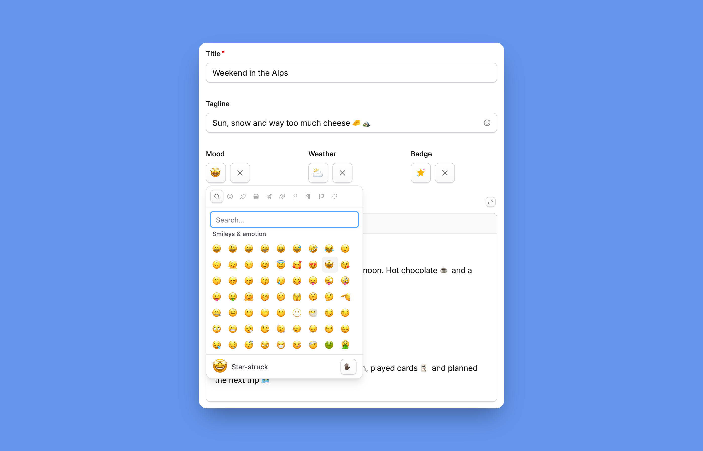

# 😄 Statamic Emojis

A Statamic 6 addon that adds an emoji picker to the Control Panel: emoji fieldtypes, a Bard button,
shortcode suggestions and, with **Pro**, custom emoji uploads. Emojis are **stored as Unicode** and can be
shown as native characters or, with **Pro**, as **Noto, Fluent or OpenMoji images**, in the Control Panel
and on the front end.

**📖 Documentation: [jeslage.github.io/statamic-emojis](https://jeslage.github.io/statamic-emojis/)**



## Features

- 😀 **Emoji fieldtype**: pick a single emoji
- ✍️ **Emoji Text fieldtype**: a text field with an emoji picker that inserts at the cursor
- 📝 **Bard button**: insert emojis into Bard
- 🔍 **Shortcode suggestions**: type `:rock` to get matching emojis
- 🎨 **Emoji sets** (Pro): Noto, Fluent, OpenMoji or your own, served from your server
- 🦜 **Custom emojis** (Pro): upload your own images and use them as `:party-parrot:`
- 🏷️ **Modifier and tag**: render emojis in Antlers and Blade
- 🔌 **REST & GraphQL**: emoji values with name and image URL
- 🌍 **Translated**: picker in `en`, `de`, `es` and `fr`, emoji names in the editor's language

Features marked **(Pro)** need a license, see [Editions](#editions).

The picker is built on [vue-frimousse](https://vue-frimousse.robertshaw.id) and uses
[Emojibase](https://emojibase.dev) data, with category tabs, search, skin tones and recently used emojis.

## Table of contents

- **Docs site:** [jeslage.github.io/statamic-emojis](https://jeslage.github.io/statamic-emojis/)
- **Getting started:** [Installation](#installation)
- **Usage:** [Fieldtypes](#fieldtypes) · [Settings](#settings) · [Emoji sets](#emoji-sets) · [Templates](#templates) ·
  [Custom emojis](#custom-emojis) · [Shortcode suggestions](#shortcode-suggestions) ·
  [API (REST & GraphQL)](#api-rest--graphql) · [Emoji data](#emoji-data) · [Translations](#translations)
- **More:** [Notes](#notes) · [Roadmap](#roadmap)
- **Development:** [Local development](#local-development) · [Tests](#tests) · [Releasing](#releasing)
- **About:** [Editions](#editions) · [License](#license) · [Credits](#credits)

## Installation

```bash
composer require jeslage/statamic-emojis
php please emojis:custom-setup   # Pro, optional: asset container for custom emojis
```

Releases ship the built Control Panel assets, which
[`pixelfear/composer-dist-plugin`](https://github.com/pixelfear/composer-dist-plugin) downloads into
`resources/dist`. **For a development branch, build them yourself** (`npm ci && npm run build`).

## Fieldtypes

- **Emoji** (`type: emoji`): a single emoji, stored as a string (`null` when removed).
- **Emoji Text** (`type: emoji_text`): the core Text field (placeholder, character limit, prepend, …)
  with a picker button. Custom emojis show as images.
- **Bard**: enable the `emoji` button in the field's toolbar config.

Both fieldtypes have these settings. **Empty values fall back to the [site-wide settings](#settings)**:

| Setting              | Default | Description                                                             |
| -------------------- | ------- | ----------------------------------------------------------------------- |
| `categories`         | all     | Categories the picker offers, e.g. `[smileys-people, animals-nature]`   |
| `skin_tone`          | `none`  | `none`, `light`, `medium-light`, `medium`, `medium-dark` or `dark`      |
| `skin_tone_selector` | `true`  | Show a skin tone button (the editor's choice is remembered per browser) |
| `custom_emojis`      | `true`  | Offer [custom emojis](#custom-emojis) (Pro)                             |

Categories: `smileys-people`, `animals-nature`, `food-drink`, `travel-places`, `activities`,
`objects`, `symbols`, `flags`.

In entry listings, listable emoji fields show their emojis like the field does.

## Settings

**Settings → Emojis** in the Control Panel (the "Statamic Emojis settings" permission, under Addons
in the role editor), saved to `resources/addons/statamic-emojis.yaml`:

- **General:** emoji set, picker defaults, recently used emojis and shortcode suggestions
- **Custom Emojis** (Pro): turn them on or off, see and upload them
- **Image Cache** (Pro): cache size per set, fill or clear it

**A field's own setting wins, then the Emojis page, then `config/statamic-emojis.php`** (and its `.env`
variables). Publish the config with:

```bash
php artisan vendor:publish --tag=statamic-emojis-config
```

## Emoji sets

> **Pro.** The free edition shows native emojis.

Emojis are always **stored as Unicode**, so the look can change any time. **The set is site-wide**
(Emojis page or `STATAMIC_EMOJIS_SET`, default `native`):

| Set        | Looks like              | License                                                                                    |
| ---------- | ----------------------- | ------------------------------------------------------------------------------------------ |
| `native`   | The device's own font   | –                                                                                          |
| `noto`     | Google / Android        | Apache 2.0 (flags: public domain)                                                          |
| `fluent`   | Microsoft Fluent (flat) | MIT                                                                                        |
| `openmoji` | OpenMoji                | CC BY-SA 4.0, **attribution required**: "Emoji graphics by OpenMoji, https://openmoji.org" |

Apple's emojis are proprietary; Apple users see them with `native`.

Image sets are SVGs the server fetches once, caches in `storage/statamic-emojis/sets` and serves from
`/!/statamic-emojis/sets/{set}/{codepoints}.svg`, so **browsers never contact a CDN**. Missing emojis fall
back to the native character.

```bash
php please emojis:warm noto      # fill the cache in advance, e.g. after deploying
php please emojis:clear noto     # empty it (without argument: all sets)
php please emojis:clear --data   # also forget the cached Emojibase data
```

### Custom sets

The config's `sets` **only lists additions or changes** to the built-in sets:

```php
// config/statamic-emojis.php
'sets' => [
    'twemoji' => [                       // a new set (lowercase letters only)
        'label' => 'Twemoji',            // text or translation key
        'url' => 'https://cdn.jsdelivr.net/gh/jdecked/twemoji@15.1.0/assets/svg',
        'naming' => 'fluent',
    ],
    'noto' => ['url' => 'https://emojis.example.com/noto'], // change a built-in set
],
'disabled_sets' => [],                   // e.g. ['fluent'], or ['*'] for native only
```

`naming` is how files are named (with and without FE0F are tried):

| `naming`   | File for 🧑‍🚀                                                                           |
| ---------- | ------------------------------------------------------------------------------------- |
| `fluent`   | `1f9d1-200d-1f680.svg` (default)                                                      |
| `openmoji` | `1F9D1-200D-1F680.svg`                                                                |
| `noto`     | `2D/svg/emoji_u1f9d1_200d_1f680.svg`                                                  |
| a class    | implementing `StatamicEmojis\Contracts\SetNaming` (`files(array $codepoints): array`) |

Sets can also be added from a service provider with `StatamicEmojis\EmojiSets::extend('twemoji', [...])`.
**Check the license of sets you add** (Twemoji needs an attribution).

## Templates

**Values print as plain text** (`{{ emoji }}` → 🎉). **The `emojis` modifier renders them in the set**, for a
single emoji, text or HTML (only text between tags is replaced):

```antlers
{{ content | emojis }}               {{# site-wide set #}}
{{ content | emojis('openmoji') }}   {{# explicit set #}}

{{ emoji:label }}                    {{# party popper #}}
{{ emoji:url }}                      {{# image URL, empty for native #}}
```

```blade
{!! Statamic::modify($page->content)->emojis() !!}
```

The `emojis` tag does the same and loops over custom emojis (`shortcode`, `emoji`, `label`, `url`,
`keywords`):

```antlers
{{ emojis :value="content" set="noto" }}
{{ emojis:url value="🎉" }}
{{ emojis:label value="🎉" }}

{{ emojis:custom }}
     {{ emoji }}
{{ /emojis:custom }}
```

```blade
<s:emojis :value="$page->content" />
```

Images get `class="emoji"`; size them with CSS, e.g.
`img.emoji { width: 1.15em; height: 1.15em; vertical-align: -0.2em; }`.

## Custom emojis

> **Pro.**

Editors can upload images (PNG, GIF, WebP or SVG, up to 1 MB) and use them by **shortcode**, e.g.
`:party-parrot:`. **Run `php please emojis:custom-setup` once**, then upload via
**Settings → Emojis → Custom Emojis**.

- **Fields:** each image has a **Name**, an optional **Shortcode** (defaults to the filename) and
  **Keywords**. Folders are only for organizing: `halloween/ghost.svg` is `:ghost:`.
- **Picker:** a "Custom" tab, and matches above the search results.
- **Values:** Emoji and Emoji Text store `:shortcode:`; Bard inserts an image node and renders it as
  ``. **Use the `emojis` modifier for the other fields.**

Shortcodes are lowercase letters, numbers, `-`, `_` and `+`. **Renaming a shortcode breaks existing
references.** Images are stored on the `statamic-emojis` disk (`public/statamic-emojis`, unless you
define one in `config/filesystems.php`). Configure with `STATAMIC_EMOJIS_CUSTOM`,
`STATAMIC_EMOJIS_CUSTOM_CONTAINER` and `STATAMIC_EMOJIS_CUSTOM_DISK`.

## Shortcode suggestions

Typing `:` and two characters (e.g. `:rock`) in Emoji Text or Bard lists matching emojis: custom ones
first, then by [Emojibase shortcode](https://emojibase.dev/docs/shortcodes), name and keywords.
↑/↓ choose, Enter or Tab insert, Escape closes. Can be turned off on the Emojis page.

## API (REST & GraphQL)

Emoji fields are objects in the API:

```json
"mood": {
    "value": "👍🏻",
    "label": "thumbs up: light skin tone",
    "url": "https://example.com/!/statamic-emojis/sets/openmoji/1f44d-1f3fb.svg",
    "set": "openmoji",
    "custom": false,
    "shortcode": null
}
```

Emoji Text fields are `{ "value": "Done 👍", "html": "Done ", "set": "noto" }`.
GraphQL has the matching types `EmojiValue` and `EmojiTextValue`:

```graphql
mood { value label url set custom shortcode }
motto { value html set }
```

## Emoji data

The picker loads Emojibase data through the Control Panel
(`/cp/statamic-emojis/emojibase/…`). The server fetches it once from jsDelivr and caches it:

```env
STATAMIC_EMOJIS_EMOJIBASE_URL=https://cdn.jsdelivr.net/npm/emojibase-data@18
STATAMIC_EMOJIS_CACHE_TTL=604800
```

## Translations

- **Addon UI:** `lang/{locale}/messages.php` (`en`, `de`, `es`, `fr`). Override them in
  `lang/vendor/statamic-emojis/{locale}/messages.php`.
- **Emoji names, categories and keywords:** from Emojibase in the editor's language (fallback `en`).

## Notes

- The picker hides emojis the editor's device can't render (e.g. flags in Chrome on Windows).
- Values are plain Unicode. If you copy them into your own MySQL columns, **use `utf8mb4`**.

## Roadmap

Ideas for upcoming versions, without dates. Suggestions are welcome as
[GitHub issues](https://github.com/jeslage/statamic-emojis/issues).

- **Reactions:** let visitors react to entries with emojis, with the counts in the Control Panel and the API
- **Emoji palettes:** limit a site or field to an approved set of emojis, or block specific ones
- **Team favorites:** shared favorites at the top of the picker
- **Forms:** an emoji field for Statamic forms, e.g. for feedback ratings

## Local development

Add the addon to a Statamic site as a path repository in the site's `composer.json`:

```json
"require": {
    "jeslage/statamic-emojis": "*"
},
"repositories": [
    { "type": "path", "url": "../statamic-emojis" }
]
```

```bash
composer update jeslage/statamic-emojis   # in the site
composer install && npm install           # in this addon (composer first: @statamic/cms comes from vendor)
npm run dev                               # HMR
npm run build                             # production build -> resources/dist
```

## Tests

```bash
vendor/bin/phpunit   # PHP
npm test             # JS (Vitest + jsdom)
```

The JS tests stub Statamic's UI components (`tests/js/stubs`). CI runs both.

## Releasing

Commits follow [Conventional Commits](https://www.conventionalcommits.org).
[release-please](https://github.com/googleapis/release-please) keeps a release PR with changelog and
version up to date; merging it creates the tag and release, and the workflow attaches `dist.tar.gz`.
The repository needs **"Allow GitHub Actions to create and approve pull requests"**.

## Editions

| Feature                                                     | Free | Pro |
| ----------------------------------------------------------- | :--: | :-: |
| Emoji and Emoji Text fieldtypes, Bard button                |  ✅   |  ✅  |
| Shortcode suggestions, recently used, skin tones            |  ✅   |  ✅  |
| `emojis` modifier and tag, REST & GraphQL                   |  ✅   |  ✅  |
| Native emojis                                               |  ✅   |  ✅  |
| [Emoji sets](#emoji-sets): Noto, Fluent, OpenMoji, your own |  –   |  ✅  |
| [Custom emojis](#custom-emojis)                             |  –   |  ✅  |

The free edition is the default. **Pro needs a license from the
[Statamic Marketplace](https://statamic.com/addons)** for each site in production; enable it in
`config/statamic/editions.php`:

```php
'addons' => [
    'jeslage/statamic-emojis' => 'pro',
],
```

## License

Statamic Emojis is commercial software: the free edition can be used free of charge, the Pro edition
needs a license per site in production. See [LICENSE](LICENSE).

## Credits

The Marketplace image (`.github/marketplace.png`) uses the
[😄 emoji (1F604)](https://openmoji.org/library/emoji-1F604/) by [OpenMoji](https://openmoji.org), the
open-source emoji and icon project, licensed under
[CC BY-SA 4.0](https://creativecommons.org/licenses/by-sa/4.0/). The image itself is available under the
same license.
